<p align="center">
  
</p>

<p align="center">
  <a href="https://github.com/halilozel1903/open-library-kotlin/actions/workflows/ci.yml"></a>
  <a href="https://jitpack.io/#halilozel1903/open-library-kotlin"></a>
  
  
  
  
  
  <a href="LICENSE"></a>
</p>

**open-library-kotlin** is a Kotlin client for the [Open Library API](https://openlibrary.org/developers/api), the free, open book catalog run by the Internet Archive. It covers book search with `fields` and paging, works, editions, ISBN lookup, authors and their works, and subjects, plus a URL builder for the Covers API. Models are typed, and text fields read the same whether Open Library sends a plain string or a `{"type": "/type/text", "value": ...}` object. Merged records (`/type/redirect`) are followed for you. The client sends a polite `User-Agent`, spaces its requests and caches responses. The core is pure Kotlin/JVM (Ktor and kotlinx.serialization), so it runs on Android, on a server and in tests. The sample app, **Shelf**, is a reading list for tablets and phones.

```kotlin
val client = OpenLibraryClient {
    userAgent = "MyBookApp/1.0 (books@example.com)"   // Open Library asks apps to identify themselves
}

val results = client.search("the left hand of darkness")
val doc = results.docs.first()
doc.title                                  // "The Left Hand of Darkness"
doc.authorLine                             // "Ursula K. Le Guin"
doc.coverUrl(CoverSize.M)                  // https://covers.openlibrary.org/b/id/{cover_i}-M.jpg?default=false

val work = client.work(doc.key)            // "/works/OL...W", "OL...W" or an openlibrary.org url
work.description                           // plain text, whichever shape Open Library used
val authors = client.authorsOf(work)       // name, bio, birth and death dates, photo
val editions = client.editions(work.olid, limit = 10)   // publishers, dates, pages, ISBNs
```

## Screenshots

Captured by CI with the sample app on Android emulators. Everything on screen is loaded live from openlibrary.org during the run: search results, works, authors, editions and subjects, with real covers and author photos from covers.openlibrary.org. The app has no bundled or demo data; a scene that does not load fails the run instead of being captured.

**Tablet (landscape):** search results with their covers, Frank Herbert's *Dune* with its author and editions, and the science fiction shelf.

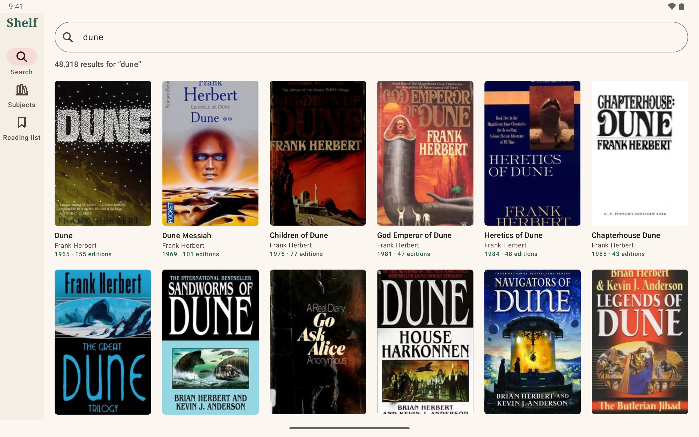

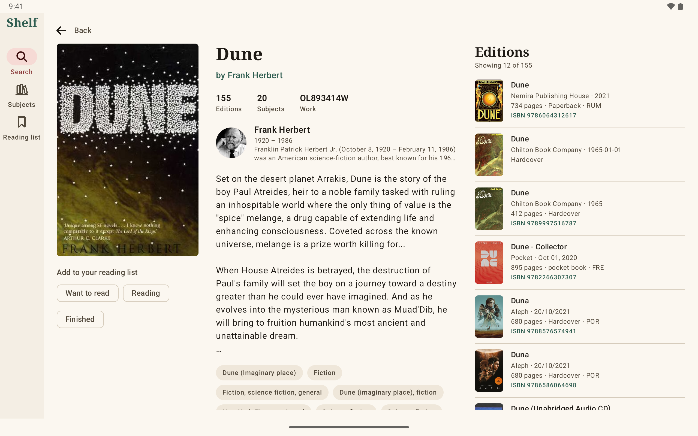

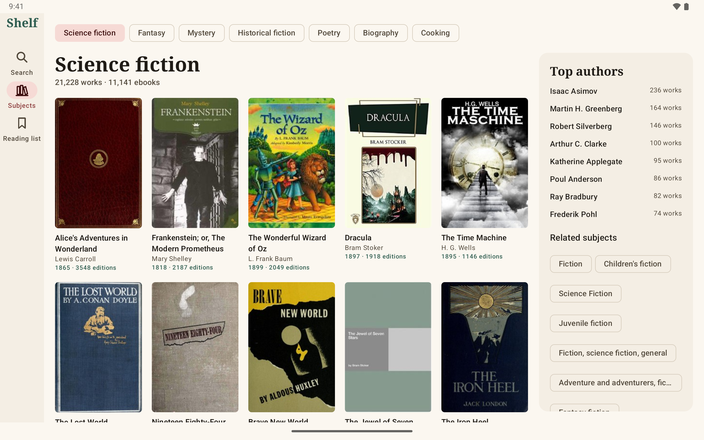

**Phone:** search, a work page and the reading list, which lives on the device. For the screenshot, six classics are looked up live by title and author and put on the list.

| Search | Work | Reading list |
| :---: | :---: | :---: |
| 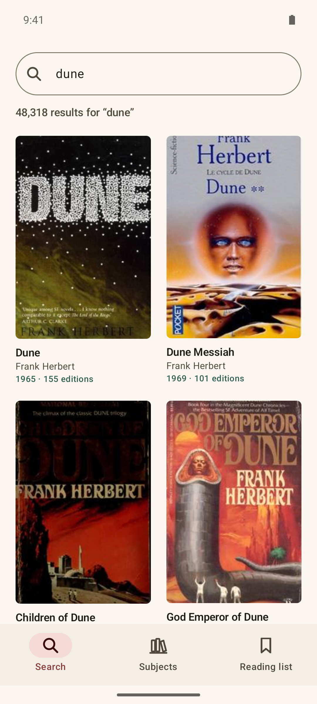 | 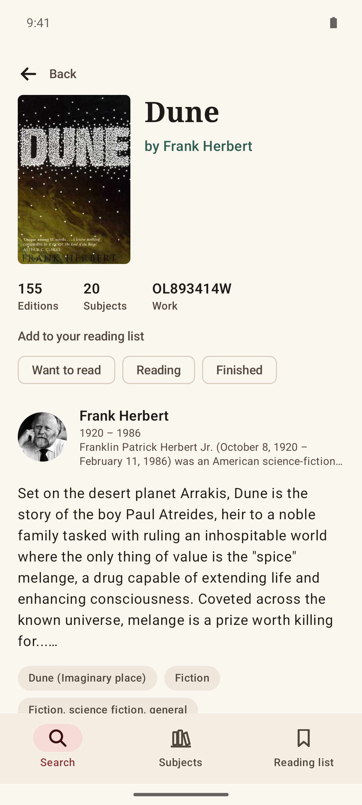 | 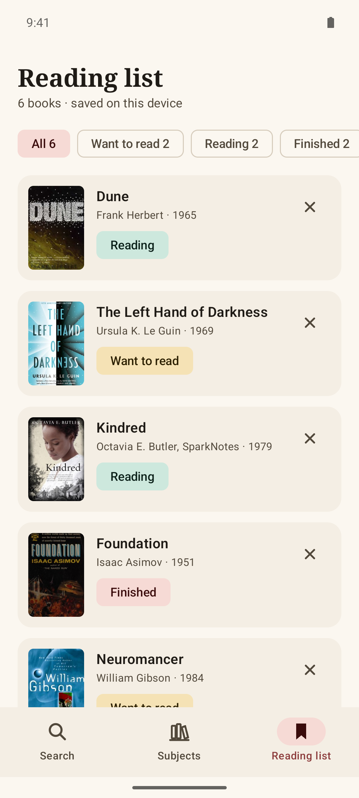 |

| Tablet search, dark | Tablet work, dark | Tablet subject, dark |
| :---: | :---: | :---: |
| 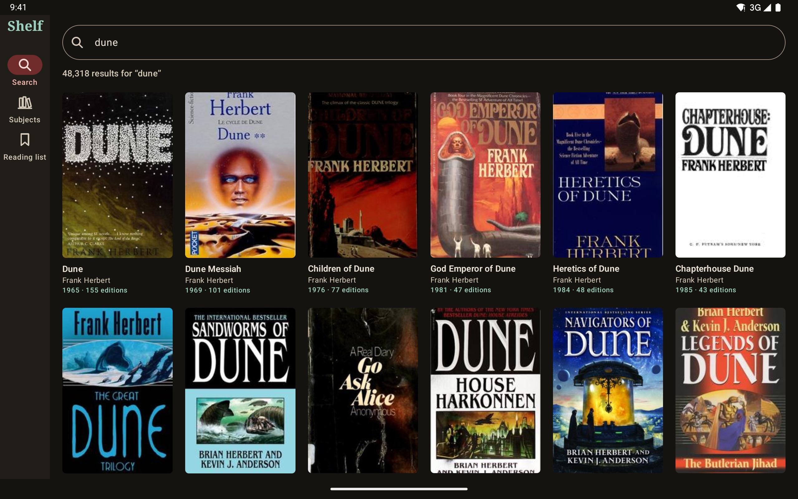 | 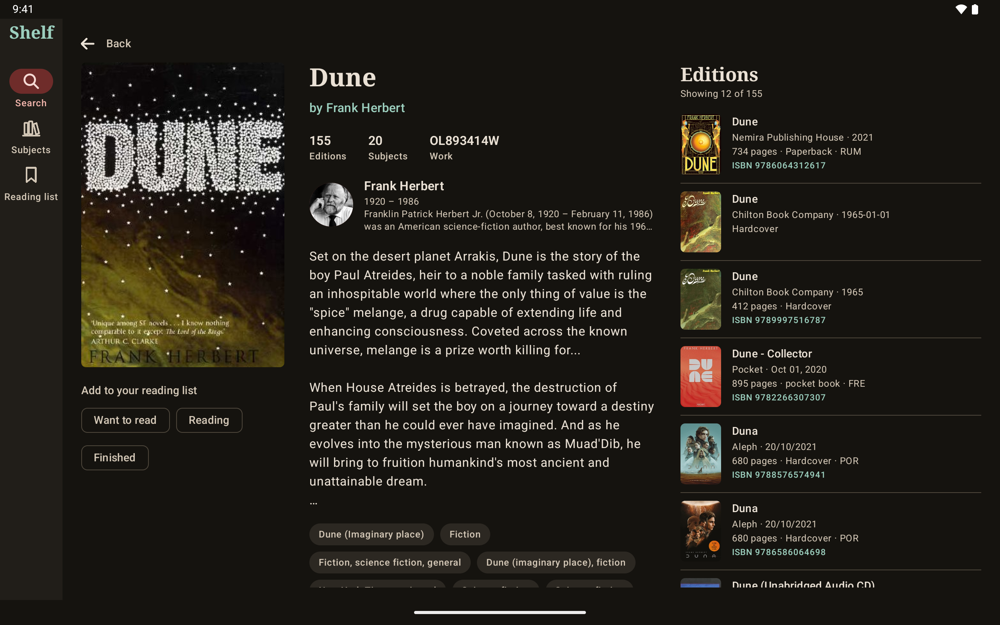 | 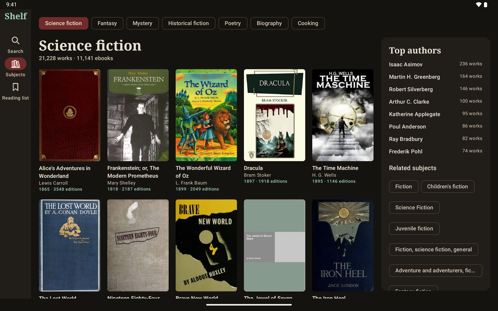 |

| Search, dark | Work, dark | Reading list, dark |
| :---: | :---: | :---: |
| 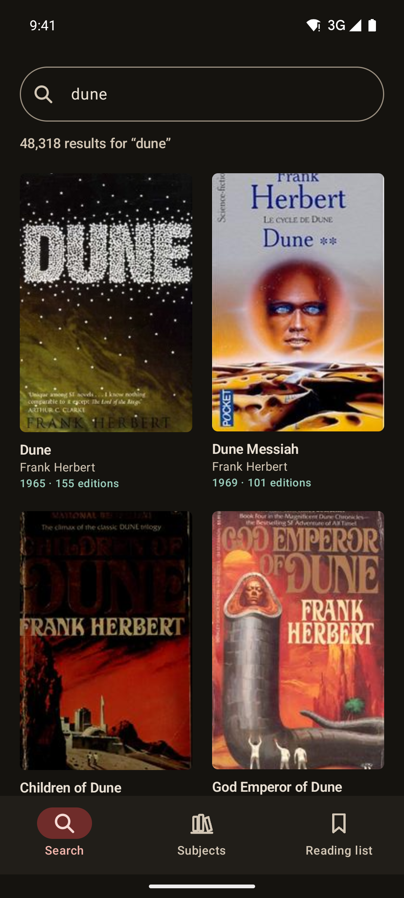 | 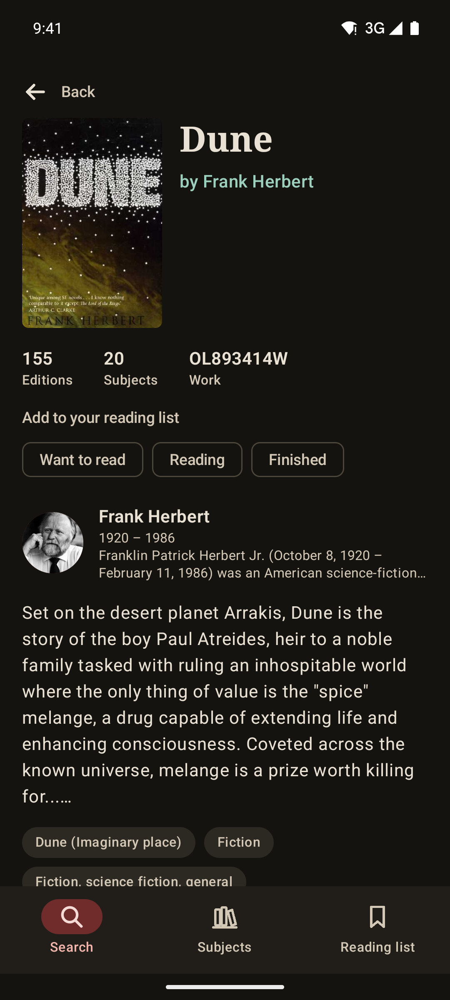 | 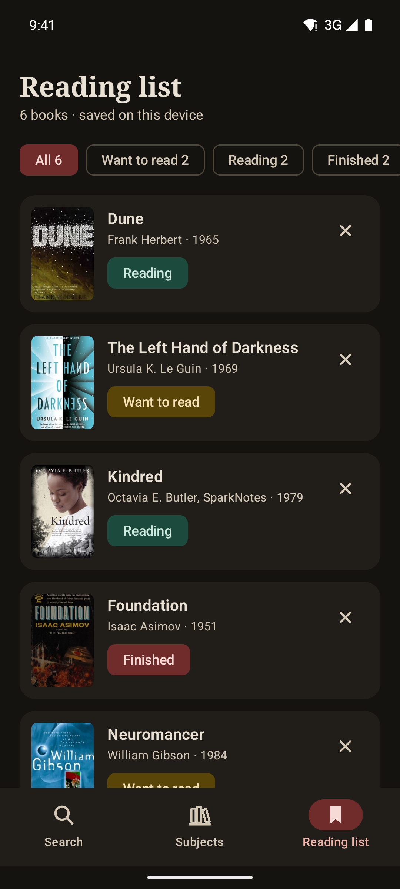 |

## Features

- **Search**: `/search.json` with free text or field filters (title, author, subject, place, person, publisher, ISBN, language, first publish years), sort orders, `fields` selection (a small default set, or everything) and paging, plus `searchPages` as a lazy `Flow`. Author search too.
- **Works, editions, authors, subjects**: `/works/{id}.json`, `/works/{id}/editions.json`, `/books/{id}.json`, `/isbn/{isbn}.json`, `/authors/{id}.json`, `/authors/{id}/works.json` and `/subjects/{name}.json` with `details`, `ebooks` and `published_in`.
- **Typed models** with Open Library's field names mapped to Kotlin properties, and helpers: `olid`, `coverId` (skips the `-1` placeholders of removed covers), `authorIds`, `firstPublishYear`, `isbn`, `languageCodes`, `lifespan`, `publishingHistoryByYear`, `webUrl`.
- **String or `{type, value}`**: `description`, `bio`, `notes`, `first_sentence`, `excerpt`, `created` and `last_modified` all decode to a `String`, whichever shape the record uses. `OpenLibraryTextSerializer` is public for your own models.
- **Tolerant decoding**: unknown fields are ignored, older records that store a link as a bare key string still decode, and one malformed entry in a page of editions or search results is left out instead of failing the page.
- **Redirects**: merged works and authors (`/type/redirect`) are followed to the record they point to; deleted records throw `NotFound`.
- **Covers API**: urls for book covers by cover id, ISBN, OLID or other identifiers, and author photos by photo id or OLID, in sizes S, M and L, with `default=false` so a missing cover is a 404 your image loader can handle.
- **Ids and ISBNs**: pass `OL27448W`, `/works/OL27448W` or a full openlibrary.org url; ids of the wrong kind fail before a request. `Isbn` validates check digits and converts between ISBN-10 and ISBN-13.
- **Polite by default**: a descriptive `User-Agent`, at most 3 requests per second (configurable), an in-memory cache with a time to live, and retries with exponential backoff that honor `Retry-After` on 429 and 5xx.
- **Coroutines**: every call is a main-safe `suspend` function that throws an `OpenLibraryException` (`NotFound`, `RateLimited`, `Http`, `Network`, `Decoding`).
- **Pluggable HTTP**: Ktor with the CIO engine by default; pass OkHttp, Android, Java or a `MockEngine`, a ready `HttpClient`, or your own `OpenLibraryTransport`.
- **Explicit API**, unit tested with a Ktor `MockEngine` and JSON fixtures shaped like Open Library's responses, both description shapes, redirects and broken records included.

### API coverage

| Open Library endpoint | Function | Returns |
| --- | --- | --- |
| `GET /search.json` | `search(q)`, `search { title = ...; author = ... }`, `search(query)`, `searchPages(query)` | `SearchResult`, `Flow<SearchResult>` |
| `GET /search/authors.json` | `searchAuthors(q, limit, offset)` | `AuthorSearchResult` |
| `GET /works/{id}.json` | `work(id)` (follows redirects) | `Work` |
| `GET /works/{id}/editions.json` | `editions(workId, limit, offset)`, `editionPages(workId)` | `EditionPage`, `Flow<EditionPage>` |
| `GET /books/{id}.json` | `edition(id)` | `Edition` |
| `GET /isbn/{isbn}.json` | `isbn(isbn)` (validated, follows the redirect to `/books/`) | `Edition` |
| `GET /authors/{id}.json` | `author(id)`, `authorsOf(work)` | `Author`, `List<Author>` |
| `GET /authors/{id}/works.json` | `authorWorks(authorId, limit, offset)` | `AuthorWorksPage` |
| `GET /subjects/{name}.json` | `subject(name, limit, offset, details, ebooks, publishedIn)` | `Subject` |
| Any url | `fetch(url, deserializer)` | your model |
| `covers.openlibrary.org/b/...` | `OpenLibraryCovers.book(coverId)`, `bookByIsbn(isbn)`, `bookByOlid(olid)`, `bookBy(identifier, value)` | url |
| `covers.openlibrary.org/a/...` | `OpenLibraryCovers.author(photoId)`, `authorByOlid(olid)` | url |

## Installation

Add JitPack to `settings.gradle.kts`:

```kotlin
dependencyResolutionManagement {
    repositories {
        google()
        mavenCentral()
        maven("https://jitpack.io")
    }
}
```

Then the dependency:

```kotlin
dependencies {
    implementation("com.github.halilozel1903.open-library-kotlin:openlibrary:1.0.0")

    // Optional: use OkHttp instead of Ktor's CIO engine.
    implementation("io.ktor:ktor-client-okhttp:3.6.0")
}
```

> The build is also set up for Maven Central (`io.github.halilozel1903:openlibrary`) via the vanniktech publish plugin.

`openlibrary` is a plain Kotlin/JVM library (JDK 17+), so it also works in server and desktop projects.

## Usage

**Create a client**

```kotlin
val client = OpenLibraryClient {
    userAgent = "MyBookApp/1.0 (books@example.com)"   // your app name and a contact
    engine = OkHttp.create()                           // default: CIO
    maxRequestsPerSecond = 3.0                         // 0 turns the limit off
    cacheSize = 200                                    // responses kept in memory; 0 turns caching off
    cacheTtl = 10.minutes
    requestTimeoutMillis = 30_000
    retries = 2                                        // network errors, 429 and 5xx, with backoff
}
// ...
client.close()
```

Create one client and share it; it is safe to use from many coroutines.

**Search**

```kotlin
// Free text, with the default fields (key, title, authors, year, cover, edition count, ratings, ...).
val page = client.search("ursula le guin", page = 1, limit = 20)
page.numFound
page.docs.map { it.title to it.firstPublishYear }

// Field filters, sorting and your own field list.
val classics = client.search {
    subject = "science fiction"
    firstPublishYear = 1950..1970
    sort = SearchSort.Editions
    fields = listOf(SearchFields.KEY, SearchFields.TITLE, SearchFields.AUTHOR_NAME, SearchFields.COVER_ID)
    limit = 50
}

// Every page, lazily.
client.searchPages(SearchQuery().apply { author = "terry pratchett"; limit = 100 })
    .take(3)
    .collect { println(it.docs.size) }

client.searchAuthors("tolkien").docs.first().topWork
```

**Works and editions**

```kotlin
val work = client.work("OL27448W")
work.title
work.description               // String?, from either a string or {"type": "/type/text", "value": ...}
work.subjects.take(5)
work.coverUrl(CoverSize.L)     // null when the work has no cover

val page = client.editions(work.olid, limit = 20)
page.size                      // how many editions in total
page.entries.map { "${it.publishers.firstOrNull()} ${it.publishDate} ${it.numberOfPages} pages, ISBN ${it.isbn}" }

client.editionPages(work.olid).collect { /* every edition, page by page */ }

val edition = client.isbn("978-0-14-032872-1")   // hyphens ignored, check digit validated
val parent = client.workOf(edition)
```

**Authors**

```kotlin
val author = client.author("OL26320A")
author.name
author.bio                     // String?, either shape
author.lifespan                // "1892 – 1973"
author.photoUrl(CoverSize.M)   // by photo id, which the Covers API does not rate limit
author.remoteId("wikidata")

client.authorWorks(author.olid, limit = 50).entries.map { it.title }
```

**Subjects**

```kotlin
val shelf = client.subject("science_fiction", limit = 24, details = true)
shelf.name                     // "Science fiction"
shelf.workCount
shelf.works.map { it.title to it.authorLine }
shelf.authors.take(5)          // top authors with their work counts (details = true)
shelf.subjects                 // related subjects
shelf.publishingHistoryByYear  // year to number of editions

client.subject("place:london")
client.subject("fantasy", ebooks = true, publishedIn = 2000..2010)
```

**Covers**

```kotlin
OpenLibraryCovers.book(coverId, CoverSize.L)          // https://covers.openlibrary.org/b/id/{id}-L.jpg?default=false
OpenLibraryCovers.bookByIsbn("9780140328721")         // .../b/isbn/9780140328721-M.jpg?default=false
OpenLibraryCovers.bookByOlid("OL7353617M", CoverSize.S)
OpenLibraryCovers.author(photoId)                     // .../a/id/{id}-M.jpg?default=false
OpenLibraryCovers.book(coverId, default = true)       // a blank image instead of a 404 when missing

// Or straight from a model (null when there is no cover):
doc.coverUrl()
work.coverUrl(CoverSize.L)
edition.coverUrl()
subjectWork.coverUrl()
author.photoUrl()
```

**Errors**

```kotlin
try {
    client.work("OL1234567890W")
} catch (e: OpenLibraryException.NotFound) {
    // no such work, or it was deleted
} catch (e: OpenLibraryException.RateLimited) {
    // e.retryAfterSeconds
} catch (e: OpenLibraryException.Network) {
    // offline or timed out
}
```

**Testing your code**

Pass a Ktor `MockEngine` as `engine`, as this library's own tests do, or replace HTTP entirely:

```kotlin
val client = OpenLibraryClient {
    transport = OpenLibraryTransport { url -> myFixtures.getValue(url) }
    maxRequestsPerSecond = 0.0
}
```

## Be polite to Open Library

Open Library is a free service run by the Internet Archive, a non-profit. Its [API guidelines](https://openlibrary.org/developers/api) ask apps to:

- **Identify themselves** with a `User-Agent` that names the app and a way to reach you, so they can contact you instead of blocking your traffic. Set `userAgent`; the default names this library and its repository.
- **Keep the request rate low.** The client starts at most `maxRequestsPerSecond` requests per second (3 by default) and caches responses, so repeated screens do not hit the API again.
- **Load covers by cover id or OLID.** The Covers API rate limits lookups by ISBN, OCLC, LCCN and other identifiers (100 per 5 minutes per IP) but not by cover id or OLID, so prefer `cover_i`, `covers` and `cover_id` with `OpenLibraryCovers.book(id)`.
- **Use the bulk data dumps** for large jobs instead of crawling the API.

## Sample app: Shelf

The `sample` module is a reading list app for tablets and phones. Search Open Library, open a work to see its cover, authors with their photos, description, subjects and editions, browse subjects such as science fiction or poetry with their top authors and related subjects, and keep a reading list (Want to read, Reading, Finished) that is stored on the device in SharedPreferences. Tablets get a navigation rail and a three column work page; phones get a bottom bar. It uses the live API, OkHttp as the Ktor engine and Coil for covers.

For screenshots it opens a fixed screen from an intent extra (used by `scripts/screenshots.sh`):

```bash
./gradlew :sample:installDebug
adb shell am start -n io.github.halilozel1903.openlibrary.sample/.MainActivity --es scene work
```

`scene` is one of `search` (results for "dune"), `work` (finds *Dune* by Frank Herbert with a live search, then opens its work page), `subject` (the science fiction shelf with details) or `reading` (looks up six classics live by title and author and puts them on a reading list kept apart from your own). Scenes load live data through the same client as a normal launch and log `SCENE_READY` once the data and every cover on screen have loaded. CI captures `search`, `work` and `subject` on a Pixel Tablet in landscape and `search`, `work` and `reading` on a Pixel 7, in light and dark mode, and fails instead of capturing when a scene shows an error, does not finish loading, misses the expected text or is blank.

## Project structure

| Module | What it is |
| --- | --- |
| `openlibrary` | Pure Kotlin/JVM: `OpenLibraryClient`, models, `OpenLibraryCovers`, `OpenLibraryIds`, `Isbn`. Published as `openlibrary` |
| `sample` | Shelf, the reading list app for tablets and phones, with screenshot scenes |

## Tech stack

Kotlin 2.4 · Ktor 3.6 (CIO, OkHttp) · kotlinx.serialization · kotlinx.coroutines · AGP 9.4 with built-in Kotlin · Gradle 9.6 · Jetpack Compose (BOM 2026.09) · Material 3 · Coil 3 (sample) · GitHub Actions with Android emulators

## Data and covers

Book data comes from [Open Library](https://openlibrary.org), an open project of the [Internet Archive](https://archive.org). Cover images and author photos are served by covers.openlibrary.org; their rights belong to their respective owners. This project is not affiliated with or endorsed by Open Library or the Internet Archive, and this repository does not include any of their data or images apart from the screenshots captured from the live service.

## License

MIT. See [LICENSE](LICENSE).
